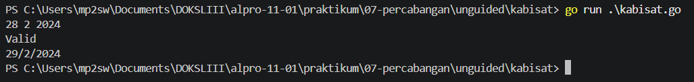
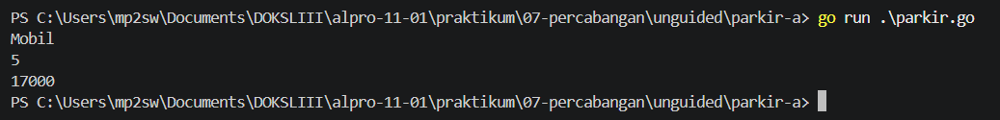

# <h1 align="center">Laporan Praktikum Modul 07 - PERCABANGAN</h1>
<p align="center">MUHAMMAD SHEIF FAHRI - 109092600016</p>

## Dasar Teori

### A. Konsep Percabangan (Branching) dalam Algoritma dan Pemrograman
Percabangan adalah salah satu struktur kontrol alur program dasar yang memungkinkan program untuk memilih jalur eksekusi kode yang berbeda berdasarkan pemenuhan suatu kondisi boolean (benar atau salah). Menurut Munir (2020), struktur pemilihan atau percabangan sangat penting dalam menyusun logika program kompleks agar komputer dapat mengambil keputusan secara dinamis menyerupai proses berpikir manusia. Dalam bahasa pemrograman Go, mekanisme percabangan umumnya diimplementasikan menggunakan struktur if-else untuk pengecekan rentang kondisi atau kondisi bertingkat, serta struktur switch-case untuk percabangan multi-arah yang memeriksa kesamaan nilai suatu variabel secara spesifik dan terstruktur.

### B. Struktur Kendali dan Pustaka Pendukung Percabangan di Go

#### 1. Percabangan Bersyarat (if, else if, dan else)
Struktur if digunakan untuk mengevaluasi satu atau lebih ekspresi logika. Jika kondisi bernilai true, blok kode di dalamnya akan dieksekusi. Apabila diperlukan pengecekan kondisi alternatif atau kondisi akhir ketika seluruh kondisi sebelumnya bernilai salah, Go menyediakan blok else if dan else. Struktur ini banyak diterapkan pada persoalan logika matematika dan penanggalan, seperti validasi tahun kabisat, penentuan jenis segitiga berdasarkan panjang sisi, serta perhitungan Indeks Massa Tubuh (BMI).

#### 2. Percabangan Banyak Pilihan (switch - case) dan Fungsi Pembulatan Matematika
Pernyataan switch merupakan alternatif pengganti if-else bertingkat yang lebih bersih dan mudah dibaca ketika menguji satu variabel terhadap banyak nilai konstan. Selain itu, dalam pembangunan logika program berbasis kasus nyata—seperti kalkulator, tarif ekspedisi, atau sistem tiket—pustaka bawaan Go seperti paket math sering digunakan, contohnya fungsi math.Ceil() untuk membulatkan nilai bilangan pecahan ke atas (seperti pembulatan berat barang dalam kilogram).

<!-- Tambahkan poin A, B, C, ... atau sub-topik 1, 2, 3, ... sesuai kebutuhan modul -->

## Guided

### 1. kabisat.go

```go
package main

import "fmt"

func main() {
	var tahun int

	fmt.Print("masukan tahun : ")
	fmt.Scan(&tahun)

	if (tahun % 400 == 0 && tahun % 100 != 0) || (tahun % 400 != 0) {
		fmt.Print("iya")
	} else {
		fmt.Print("tidak")
	}
}


```
#### Deskripsi
Menentukan apakah suatu tahun merupakan tahun kabisat atau bukan berdasarkan kondisi kelipatan 4, 100, dan 400.

### 2. segitiga.go

```go
package main

import "fmt"

func main() {
	var a, b, c int
	fmt.Print("masukan sisi segitig : ")
	fmt.Scan(&a, &b, &c)

	if a <= 0 || b <= 0 || c <= 0 || a+b <= b || b+c <= a {
		fmt.Println("bukan segitiga")
	} else if a == b && b == c {
		fmt.Println("segitiga sama sisi")
	} else if a == b ||a == c || b == c {
		fmt.Println("segitiga sama kaki")
	} else {
		fmt.Print("segitiga sembarang")
	}


}
```
#### Deskripsi
Menentukan jenis segitiga (sama sisi, sama kaki, sembarang, atau bukan segitiga) berdasarkan kombinasi panjang ketiga sisinya.

### 3. kalkulator.go

```go
package main

import "fmt"

func main() {
	var a, b int
	var op string
	fmt.Scan(&a, &op, &b)

	switch op {
	case "+":
		fmt.Println(a + b)
	case "-":
		fmt.Println(a - b)
	case "*":
		fmt.Println(a * b)
	case "/":
		if b == 0 {
			fmt.Println("Error: pembagian dengan nol")
		} else {
			fmt.Printf("%.2f\n", float64(a)/float64(b))
		}
	case "%":
		if b == 0 {
			fmt.Println("Error: pembagian dengan nol")
		} else {
			fmt.Println(a % b)
		}
	default:
		fmt.Println("Operator tidak valid")
	}
}
```
#### Deskripsi
Mengoperasikan kalkulator sederhana untuk dua bilangan berdasarkan pilihan operator, serta menangani pembagian dengan angka nol.

### 4. ongkir.go

```go
package main

import(
	"fmt"
	"math"
)

func main() {
	var berat float64
	var zona int
	var layanan string

	fmt.Scan(&berat, &zona, &layanan)

	if berat > 30 {
		fmt.Printf("berat melebihi batas maksimum 30kg")
		return 
	}

	var tarifPerKg int

	switch zona {
	case 1:
		tarifPerKg = 10000
	case 2:
		tarifPerKg = 15000
	case 3: 
		tarifPerKg = 25000
	case 4: 
		fmt.Print("zona tidak valid")
		return
	}

	beratBulat := int(math.Ceil(berat))
	total := beratBulat * tarifPerKg

	if layanan == "Express" {
		total += total + total/2
		
	}

	fmt.Println(beratBulat)
	fmt.Println(total)
}
```
#### Deskripsi
Menghitung biaya pengiriman paket berdasarkan zona tujuan, jenis layanan, dan berat paket yang dibulatkan ke atas.

<!-- Tambahkan blok file/kode lain sesuai jumlah file pada soal guided -->

## Unguided

### 1. besok

```go
package main

import "fmt"

func isKabisat(tahun int) bool {
	return (tahun%4 == 0 && tahun%100 != 0) || (tahun%400 == 0)
}

func getJumlahHari(bulan, tahun int) int {
	switch bulan {
	case 1, 3, 5, 7, 8, 10, 12:
		return 31
	case 4, 6, 9, 11:
		return 30
	case 2:
		if isKabisat(tahun) {
			return 29
		}
		return 28
	default:
		return 0
	}
}

func main() {
	var t, b, th int
	fmt.Scan(&t, &b, &th)

	maxHari := getJumlahHari(b, th)

	if b < 1 || b > 12 || t < 1 || t > maxHari {
		fmt.Println("Tidak valid")
		return
	}

	fmt.Println("Valid")

	t++
	if t > maxHari {
		t = 1
		b++
		if b > 12 {
			b = 1
			th++
		}
	}

	fmt.Printf("%d/%d/%d\n", t, b, th)
}
```

##### Output
<!-- Path relatif dari readme.md ke folder unguided/[nama_soal]/output.png, contoh: -->



#### Deskripsi
Memvalidasi tanggal yang diinput dan menentukan tanggal lengkap keesokan harinya dengan memperhitungkan pergantian bulan dan tahun.

### 2. parkir

```go
package main

import "fmt"

func main() {
	var jenis string
	var jam int
	fmt.Scan(&jenis, &jam)

	var total int
	if jenis == "Mobil" {
		total = 5000 + (jam-1)*3000
		if jam > 24 {
			total += 50000
		}
	} else if jenis == "Motor" {
		total = 3000 + (jam-1)*2000
		if jam > 24 {
			total += 30000
		}
	}

	fmt.Println(total)
}
```

##### Output


#### Deskripsi
Menhitung total biaya parkir kendaraan berdasarkan durasi jam dan menerapkan denda jika durasi melebihi 24 jam.
<!-- Duplikasi blok "### [nama_soal]" sesuai jumlah folder soal di dalam unguided -->


## Kesimpulan
Kesimpulan dari praktikum Modul 07 ini adalah struktur percabangan seperti if-else dan switch-case dalam bahasa Go sangat efektif digunakan untuk menyelesaikan permasalahan logika kompleks dan pengambilan keputusan dinamis. Melalui pemanfaatan operator logika serta pustaka bawaan, program dapat berhasil mengeksekusi berbagai kasus mulai dari penentuan tahun kabisat, validasi tanggal, hingga perhitungan tarif dan pengkategorian data secara tepat.

## Referensi
1. Munir, R. (2020). Algoritma dan Pemrograman dalam Bahasa Pascal, C, dan C++ (Edisi Revisi). Bandung: Informatika.
2. Donovan, A. A. A., & Kernighan, B. W. (2015). The Go Programming Language. Addison-Wesley Professional.
<!-- Tambahkan nomor referensi berikutnya sesuai kebutuhan -->
