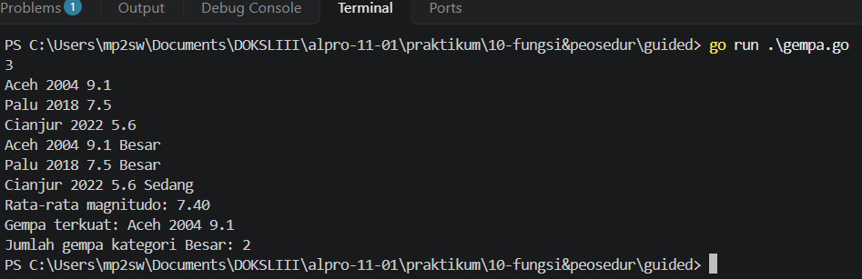

# <h1 align="center">Laporan Praktikum Modul 10 - FUNGSI</h1>
<p align="center">MUHAMMAD SHEIF FAHRI - 109092600016 </p>

## Dasar Teori

### A. Konsep Fungsi dalam Bahasa Pemrograman Go
Fungsi adalah blok kode terpisah untuk menjalankan tugas spesifik agar program menjadi modular dan mudah dikelola (Donovan & Kernighan, 2015). Deklarasinya diawali kata kunci func, diikuti nama fungsi, parameter, tipe nilai kembalian (return type), serta diakhiri pernyataan return untuk mengembalikan hasil perhitungan.

### B. Parameter, Nilai Kembalian, dan Pengolahan Data Terstruktur

#### 1. Mekanisme Pass by Value
Bahasa Go mengirimkan salinan nilai argumen ke parameter fungsi (pass by value). Mekanisme ini memastikan data asli tetap aman dan tidak berubah selama proses pembacaan maupun perhitungan berlangsung.

#### 2. struct dan array Statis sebagai Parameter
Kumpulan data majemuk disimpan menggunakan tipe bentukan struct di dalam array berukuran tetap ([NMAX]type). Data tersebut dikirim sebagai parameter beserta jumlah elemen n untuk diproses dengan perulangan dan percabangan.

<!-- Tambahkan poin A, B, C, ... atau sub-topik 1, 2, 3, ... sesuai kebutuhan modul -->

## Guided

### 1. player.go

```go
package main

import "fmt"

// Fungsi untuk mengecek tahun kabisat
func kabisat(tahun int) bool {
	return (tahun%4 == 0 && tahun%100 != 0) || (tahun%400 == 0)
}

// Fungsi untuk mengembalikan jumlah hari pada bulan tertentu dalam suatu tahun
func jumlahHari(bulan, tahun int) int {
	var hari int
	if bulan == 2 {
		if kabisat(tahun) {
			hari = 29
		} else {
			hari = 28
		}
	} else if bulan == 4 || bulan == 6 || bulan == 9 || bulan == 11 {
		hari = 30
	} else {
		hari = 31
	}
	return hari
}

// Fungsi untuk menghitung hari ke-berapa dalam tahun tersebut menggunakan perulangan
func hariKe(tanggal, bulan, tahun int) int {
	var total int = 0
	var i int
	for i = 1; i < bulan; i++ {
		total = total + jumlahHari(i, tahun)
	}
	total = total + tanggal
	return total
}

func main() {
	var tanggal, bulan, tahun int
	fmt.Scan(&tanggal, &bulan, &tahun)

	// Menghitung urutan hari dalam tahun
	urutanHari := hariKe(tanggal, bulan, tahun)

	// Menentukan jumlah total hari dalam satu tahun (kabisat = 366, biasa = 365)
	var totalHariTahun int
	if kabisat(tahun) {
		totalHariTahun = 366
	} else {
		totalHariTahun = 365
	}

	// Menghitung sisa hari hingga akhir tahun
	sisaHari := totalHariTahun - urutanHari

	// Menampilkan keluaran sesuai format
	fmt.Printf("Hari ke-%d\n", urutanHari)
	fmt.Printf("Sisa hari dalam tahun %d: %d\n", tahun, sisaHari)
}
```
#### Deskripsi
Program ini menghitung rata-rata skor, mencari indeks pemain dengan skor tertinggi, dan menghitung jumlah pemain yang skornya melebihi rata-rata.

<!-- Tambahkan blok file/kode lain sesuai jumlah file pada soal guided -->

## Unguided

### 1. gempa.go

```go
package main

import "fmt"

const NMAX int = 999

type gempa struct {
	nama      string
	tahun     int
	magnitudo float64
}

type tabGempa [NMAX]gempa

func kategori(m float64) string {
	if m < 4.0 {
		return "Minor"
	} else if m < 6.0 {
		return "Sedang"
	} else if m < 7.0 {
		return "Kuat"
	} else {
		return "Besar"
	}
}

func rataMagnitudo(T tabGempa, n int) float64 {
	var total float64 = 0.0
	for i := 0; i < n; i++ {
		total += T[i].magnitudo
	}
	return total / float64(n)
}

func idxTerkuat(T tabGempa, n int) int {
	var maxIdx int = 0
	for i := 1; i < n; i++ {
		// Menggunakan '>' agar gempa pertama yang muncul tetap terpilih jika magnitudonya sama
		if T[i].magnitudo > T[maxIdx].magnitudo {
			maxIdx = i
		}
	}
	return maxIdx
}

func hitungKategori(T tabGempa, n int, k string) int {
	var count int = 0
	for i := 0; i < n; i++ {
		if kategori(T[i].magnitudo) == k {
			count++
		}
	}
	return count
}

func main() {
	var data tabGempa
	var n int

	fmt.Scan(&n)
	for i := 0; i < n; i++ {
		fmt.Scan(&data[i].nama, &data[i].tahun, &data[i].magnitudo)
	}

	for i := 0; i < n; i++ {
		kat := kategori(data[i].magnitudo)
		fmt.Printf("%s %d %.1f %s\n", data[i].nama, data[i].tahun, data[i].magnitudo, kat)
	}

	avg := rataMagnitudo(data, n)
	strongestIdx := idxTerkuat(data, n)
	totalBesar := hitungKategori(data, n, "Besar")

	fmt.Printf("Rata-rata magnitudo: %.2f\n", avg)
	fmt.Printf("Gempa terkuat: %s %d %.1f\n", data[strongestIdx].nama, data[strongestIdx].tahun, data[strongestIdx].magnitudo)
	fmt.Printf("Jumlah gempa kategori Besar: %d\n", totalBesar)
}
```




#### Deskripsi
Program ini mengelompokkan magnitudo gempa ke dalam kategori tertentu, mencari rata-rata magnitudo, menentukan gempa terkuat, dan menghitung jumlah gempa berkategori Besar dengan memanggil fungsi kategori di dalam fungsi hitungKategori.


<!-- Duplikasi blok "### [nama_soal]" sesuai jumlah folder soal di dalam unguided -->


## Kesimpulan
Penerapan konsep fungsi pada bahasa Go berhasil memisahkan logika pengolahan data struct dan array statis ke dalam subprogram modular. Pemanggilan fungsi yang mengembalikan nilai secara terpisah maupun bertingkat terbukti menghasilkan perhitungan rata-rata, pencarian nilai tertinggi, dan pengelompokan kategori secara akurat sesuai spesifikasi.

## Referensi
1. Donovan, A. A. A., & Kernighan, B. W. (2015). The Go Programming Language. New York: Addison-Wesley Professional. Diakses pada 23 November 2026 melalui Open Library Telkom University

2. The Go Authors. (2026). The Go Programming Language Specification. Mountain View: Google. Diakses pada 23 November 2026 melalui https://go.dev/ref/spec

3. Tim Asisten Praktikum Laboratorium Informatika. (2026). Modul 10: Algoritma dan Pemrograman 2 - Fungsi (Bahasa Pemrograman Go). Bandung: Fakultas Informatika Universitas Telkom.
<!-- Tambahkan nomor referensi berikutnya sesuai kebutuhan -->
