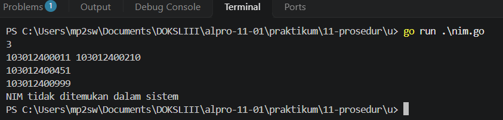

# <h1 align="center">Laporan Praktikum Modul 11 - PROSEDUR</h1>
<p align="center">MUHAMMAD SHEIF FAHRI - 109092600016</p>

## Dasar Teori

### A. Prosedur dan Pointer pada Bahasa Go
Prosedur adalah subprogram yang menjalankan serangkaian perintah tanpa mengembalikan nilai (return value), yang di dalam Go dideklarasikan menggunakan kata kunci func tanpa tipe keluaran. Menurut Donovan dan Kernighan (2015), Go menggunakan mekanisme pass-by-value sehingga setiap argumen yang dikirim ke subprogram akan disalin. Agar prosedur dapat memodifikasi data asli milik pemanggil (mode out atau in/out), digunakan pointer dengan operator & untuk mengambil alamat memori dan * untuk mengubah nilainya secara langsung.

### B. Manipulasi Array Statis di Go

#### 1. Deklarasi dan Pengiriman Array sebagai Parameter
Array di Go merupakan struktur data berurutan dengan ukuran tetap yang diindeks mulai dari 0 hingga N-1. Karena bersifat value type, pengiriman array berukuran besar secara langsung akan menyalin seluruh elemennya, sehingga parameter pointer (*Arr) digunakan agar perubahan elemen berlangsung langsung pada array asal.

#### 2. Pergeseran Elemen dan Pencarian Sekuensial
Operasi dasar pada array mencakup rotasi elemen serta pencarian berurutan (sequential search). Pada pergeseran sebanyak $K$ langkah untuk array berukuran $N$, iterasi dapat dioptimalkan dengan operasi modulo (K % N) karena susunan elemen selalu berulang setiap $N$ kali pergeseran.

<!-- Tambahkan poin A, B, C, ... atau sub-topik 1, 2, 3, ... sesuai kebutuhan modul -->

## Guided

### 1. sapi.go

```go
package main

import "fmt"

const NMAX = 10000

type Arr [NMAX]int

func mengisiSapi(T *Arr, n int) {
	for i := 0; i < n; i++ {
		fmt.Scan(&T[i])
	}
}

func geserKanan(T *Arr, n int) {
	var temp int = T[n-1]

	for i := n - 1; i > 0; i-- {
		T[i] = T[i-1]
	}

	T[0] = temp
}

func cetak(T Arr, n int) {
	for i := 0; i < n; i++ {
		fmt.Print(T[i], " ")
	}
	fmt.Println()
}

func main() {
	var n, k int
	fmt.Scan(&n, &k)

	var T Arr
	mengisiSapi(&T, n)

	k = k % n

	for i := 0; i < k; i++ {
		geserKanan(&T, n)
	}

	cetak(T, n)

}
```
#### Deskripsi
Program ini mensimulasikan pergeseran posisi nomor sapi dalam kandang ke arah kanan sebanyak $K$ hari (di mana elemen terakhir pindah ke posisi pertama) secara efisien menggunakan operasi modulo K % N agar tidak melakukan perulangan berlebih.


## Unguided

### 1. nim.go


```go
package main

import "fmt"

const NMAX int = 2002

type tabNIM [NMAX]int

func cariNIM(T tabNIM, n, x int, idx *int) {
	*idx = -1
	for i := 0; i < n; i++ {
		if T[i] == x {
			*idx = i
			return
		}
	}
}

func ubahNIM(T *tabNIM, idx, baru int) {
	T[idx] = baru
}

func cetak(T tabNIM, n int) {
	for i := 0; i < n; i++ {
		fmt.Println(T[i])
	}
}

func main() {
	var T tabNIM
	var n, cari, baru, idx int

	// Input jumlah mahasiswa dan daftar NIM
	fmt.Scan(&n)
	for i := 0; i < n; i++ {
		fmt.Scan(&T[i])
	}

	// Input NIM yang dicari
	fmt.Scan(&cari)

	cariNIM(T, n, cari, &idx)

	if idx != -1 {
		// Jika ditemukan, baca NIM pengganti
		fmt.Scan(&baru)
		ubahNIM(&T, idx, baru)

		fmt.Printf("Mahasiswa dengan NIM %d terdaftar pada posisi ke-%d\n", cari, idx+1)
		fmt.Println("Daftar NIM setelah terjadi perubahan data:")
		cetak(T, n)
	} else {
		fmt.Println("NIM tidak ditemukan dalam sistem")
	}
}
```

##### Output
<!-- Path relatif dari readme.md ke folder unguided/[nama_soal]/output.png, contoh: -->



#### Deskripsi
Program ini melakukan pencarian berurutan terhadap suatu NIM mahasiswa di dalam daftar, lalu memperbaruinya dengan NIM pengganti secara langsung melalui pointer jika data ditemukan, atau menampilkan pesan kesalahan jika tidak terdaftar.

#### Kesimpulan
Praktikum ini menunjukkan bahwa prosedur pada Go efektif untuk memecah alur program menjadi modul terpisah, dengan penggunaan pointer (& dan *) agar perubahan array pada sapi.go dan nim.go tersimpan secara permanen. Selain itu, penerapan operasi modulo K % N terbukti mengoptimalkan proses pergeseran array agar tidak melakukan iterasi berlebih, sementara pencarian sekuensial mampu melacak indeks NIM untuk pembaruan data secara tepat.

## Referensi
1. Donovan, A. A. A., & Kernighan, B. W. (2015). The Go Programming Language. Boston: Addison-Wesley Professional. Diakses pada 24 November 2026 melalui https://www.gopl.io/
2. Go Team. (2011). Go Slices: usage and internals. The Go Blog. Diakses pada 24 November 2026 melalui https://go.dev/blog/slices-intro
3. Go Team. (t.t.). Effective Go. The Go Programming Language Documentation. Diakses pada 24 November 2026 melalui https://go.dev/doc/effective_go
<!-- Tambahkan nomor referensi berikutnya sesuai kebutuhan -->
