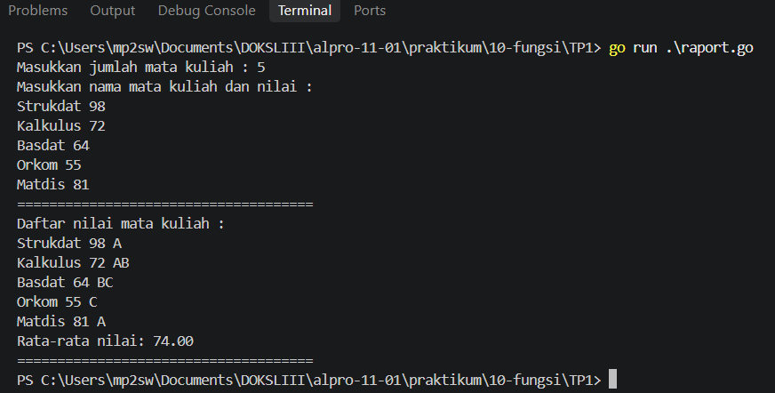
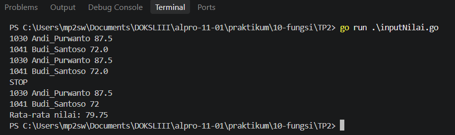

# <h1 align="center">Tugas Pendahuluan Modul 10 - FUNGSI</h1>
<p align="center">MUHAMMAD SHEIF FAHIR - 109092600016</p>

### 1. raport.go

```go
package main

import "fmt"

const NMAX int = 999

type rapot struct {
	matkul string
	nilai  int
}

type tabRapot [NMAX]rapot

func nilaiHuruf(x int) string {
	if x > 80 {
		return "A"
	} else if x > 70 {
		return "AB"
	} else if x > 65 {
		return "B"
	} else if x > 60 {
		return "BC"
	} else if x > 50 {
		return "C"
	} else if x > 40 {
		return "D"
	} else {
		return "E"
	}
}

func rataRata(T tabRapot, n int) float64 {
	var total int = 0
	for i := 0; i < n; i++ {
		total += T[i].nilai
	}
	return float64(total) / float64(n)
}

func main() {
	var T tabRapot
	var n int

	fmt.Scan(&n)
	for i := 0; i < n; i++ {
		fmt.Scan(&T[i].matkul, &T[i].nilai)
	}

	for i := 0; i < n; i++ {
		fmt.Println(T[i].matkul, T[i].nilai, nilaiHuruf(T[i].nilai))
	}

	fmt.Printf("Rata-rata nilai: %.2f\n", rataRata(T, n))
}
```

##### Output
<!-- Path relatif dari readme.md ke folder unguided/[nama_soal]/output.png, contoh: -->



#### Deskripsi
Program ini membaca sejumlah $N$ data mata kuliah beserta nilainya, mengonversi nilai angka ke huruf melalui fungsi nilaiHuruf, lalu menghitung rata-rata seluruh nilai melalui fungsi rataRata.

### 2. inputNilai.go

```go
package main

import "fmt"

const NMAX int = 100

type student struct {
	nim, name string
	grade     float64
}

type students [NMAX]student

func cariNIM(T students, n int, nim string) int {
	for i := 0; i < n; i++ {
		if T[i].nim == nim {
			return i
		}
	}
	return -1
}

func rataRata(T students, n int) float64 {
	var total float64 = 0.0
	for i := 0; i < n; i++ {
		total += T[i].grade
	}
	return total / float64(n)
}

func main() {
	var T students
	var n int = 0
	var nim, name string
	var grade float64

	for {
		fmt.Scan(&nim)
		if nim == "STOP" {
			break
		}
		fmt.Scan(&name, &grade)

		if cariNIM(T, n, nim) == -1 && n < NMAX {
			T[n].nim = nim
			T[n].name = name
			T[n].grade = grade
			n++
		}
	}

	for i := 0; i < n; i++ {
		fmt.Println(T[i].nim, T[i].name, T[i].grade)
	}

	fmt.Printf("Rata-rata nilai: %.2f\n", rataRata(T, n))
}
```

##### Output
<!-- Path relatif dari readme.md ke folder unguided/[nama_soal]/output.png, contoh: -->



#### Deskripsi
Program ini terus membaca data mahasiswa sampai ditemukan NIM bernilai "STOP". Fungsi cariNIM memeriksa apakah NIM sudah pernah disimpan sebelumnya; jika belum (-1), data ditambahkan ke dalam array.

## Kesimpulan
singkat saja maksimal satu paragraf pendek
Kedua program tersebut menerapkan pemrograman terstruktur dalam bahasa Go untuk mengolah data terstruktur menggunakan struct dan array, di mana proses pemrosesan logika dipisahkan ke dalam subprogram berupa fungsi yang mengembalikan nilai. Program pertama berfokus pada konversi nilai dan perhitungan rata-rata berdasarkan jumlah data yang sudah ditentukan, sedangkan program kedua berfokus pada validasi input menggunakan pencarian sekuensial guna menyaring data duplikat sebelum menghitung nilai rata-ratanya.

