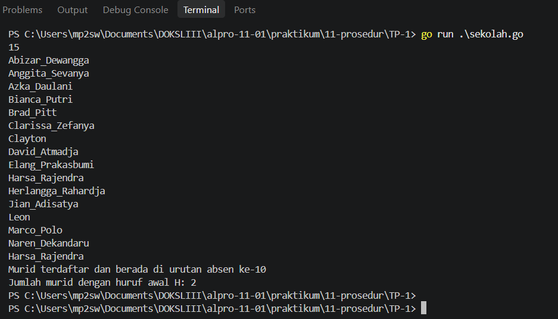
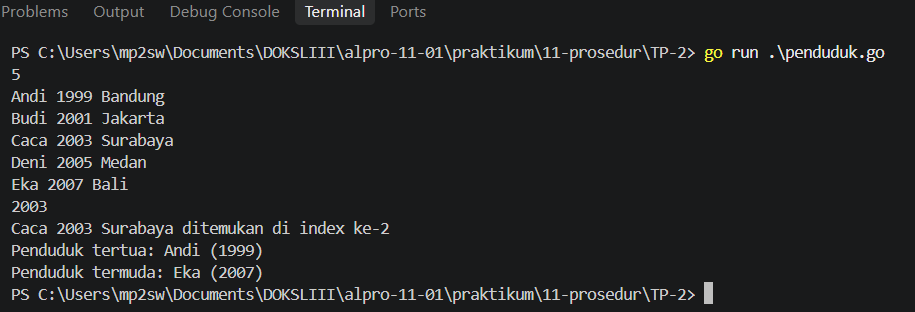

# <h1 align="center">Tugas Pendahuluan Modul 11 - PROSEDUR </h1>
<p align="center">MUHAMMAD SHEIF FAHRI - 109092600016 </p>

### 1. sekolah.go

```go
package main

import "fmt"

const NMAX int = 1001

type tabMurid [NMAX]string

func cariMurid(T tabMurid, n int, nama string, posisi *int, ketemu *bool) {
	*ketemu = false
	for i := 0; i < n; i++ {
		if T[i] == nama {
			*ketemu = true
			*posisi = i + 1 // urutan absen dimulai dari 1
			return
		}
	}
}

func hitungHuruf(T tabMurid, n int, h byte, jumlah *int) {
	*jumlah = 0
	for i := 0; i < n; i++ {
		if len(T[i]) > 0 && T[i][0] == h {
			*jumlah++
		}
	}
}

func main() {
	var T tabMurid
	var n, posisi, jumlah int
	var namaCari string
	var ketemu bool

	// Input jumlah murid
	fmt.Scan(&n)

	// Input daftar nama murid
	for i := 0; i < n; i++ {
		fmt.Scan(&T[i])
	}

	// Input nama yang dicari
	fmt.Scan(&namaCari)

	// Pemanggilan prosedur
	cariMurid(T, n, namaCari, &posisi, &ketemu)
	hitungHuruf(T, n, namaCari[0], &jumlah)

	// Output hasil
	if ketemu {
		fmt.Printf("Murid terdaftar dan berada di urutan absen ke-%d\n", posisi)
	} else {
		fmt.Println("Murid tidak terdaftar")
	}
	fmt.Printf("Jumlah murid dengan huruf awal %c: %d\n", namaCari[0], jumlah)
}
```

##### Output
<!-- Path relatif dari readme.md ke folder unguided/[nama_soal]/output.png, contoh: -->



#### Deskripsi
Pada soal pertama, tabMurid digunakan sebagai array untuk menyimpan nama murid. Karena cariMurid dan hitungHuruf hanya membaca data tanpa mengubah isi array, parameter T dikirim secara by value (in), sedangkan variabel hasil (posisi, ketemu, dan jumlah) dikirim menggunakan pointer (out).

### 2. penduduk.go

```go
package main

import "fmt"

const NMAX int = 1000

type penduduk struct {
	nama  string
	tahun int
	kota  string
}

type tabPenduduk [NMAX]penduduk

func cariTahun(T tabPenduduk, n, th int, idx *int) {
	*idx = -1
	for i := 0; i < n; i++ {
		if T[i].tahun == th {
			*idx = i
			return // berhenti di data pertama yang cocok
		}
	}
}

func tertuaTermuda(T tabPenduduk, n int, tua, muda *penduduk) {
	*tua = T[0]
	*muda = T[0]

	for i := 1; i < n; i++ {
		if T[i].tahun < (*tua).tahun {
			*tua = T[i]
		}
		if T[i].tahun > (*muda).tahun {
			*muda = T[i]
		}
	}
}

func main() {
	var T tabPenduduk
	var n, thCari, idx int
	var tua, muda penduduk

	// Input jumlah data penduduk
	fmt.Scan(&n)

	// Input data nama, tahun lahir, dan kota
	for i := 0; i < n; i++ {
		fmt.Scan(&T[i].nama, &T[i].tahun, &T[i].kota)
	}

	// Input tahun lahir yang dicari
	fmt.Scan(&thCari)

	// Pemanggilan prosedur
	cariTahun(T, n, thCari, &idx)
	tertuaTermuda(T, n, &tua, &muda)

	// Output hasil
	if idx != -1 {
		fmt.Printf("%s %d %s ditemukan di index ke-%d\n", T[idx].nama, T[idx].tahun, T[idx].kota, idx)
	} else {
		fmt.Println("Data tidak ditemukan")
	}
	fmt.Printf("Penduduk tertua: %s (%d)\n", tua.nama, tua.tahun)
	fmt.Printf("Penduduk termuda: %s (%d)\n", muda.nama, muda.tahun)
}
```

##### Output
<!-- Path relatif dari readme.md ke folder unguided/[nama_soal]/output.png, contoh: -->



#### Deskripsi
Pada soal kedua, digunakan tipe bentukan (struct) penduduk dan array tabPenduduk. Prosedur tertuaTermuda membandingkan tahun lahir untuk mencari nilai terkecil (tertua) dan terbesar (termuda), kemudian mengembalikan keseluruhan data struct melalui pointer *penduduk.

## Kesimpulan
Kedua program di atas dibuat menggunakan bahasa Go dengan menerapkan konsep prosedur (fungsi tanpa nilai balik) dan pengelolaan data kompleks seperti array serta struktur data (struct). Program pertama (sekolah.go) berfokus pada pencarian nama murid dan penghitungan huruf awal menggunakan parameter pointer untuk mengirimkan hasil keluaran, sementara program kedua (penduduk.go) mengelola data kependudukan untuk mencari tahun lahir tertentu sekaligus menyeleksi data penduduk tertua dan termuda secara efisien melalui perbandingan nilai dalam array.