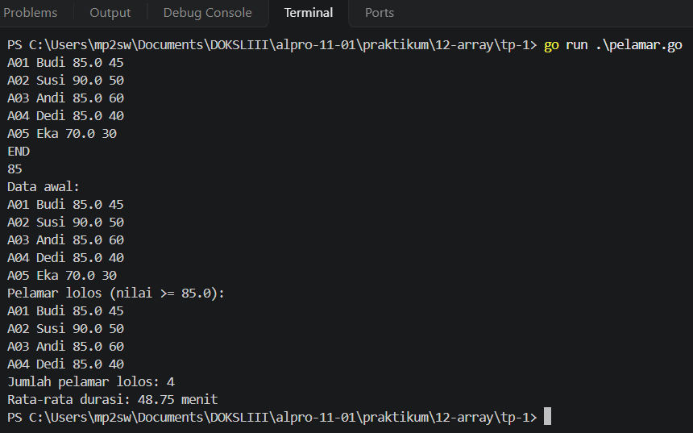
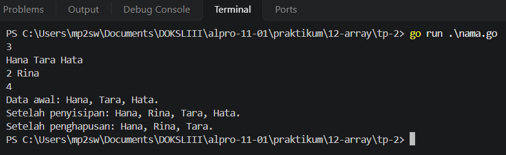

# <h1 align="center">Tugas Pendahuluan Modul 12 - array </h1>
<p align="center">MUHAMMAD SHEIF FAHRI - 109092600016 </p>

### 1. Pelamar

```go
package main

import "fmt"

const NMAX int = 100

type applicant struct {
	id, name     string
	testGrade    float64
	testDuration int
}

type applicants [NMAX]applicant

func salinLolos(A applicants, n int, batas float64, B *applicants, m *int) {
	*m = 0
	for i := 0; i < n; i++ {
		if A[i].testGrade >= batas {
			B[*m] = A[i]
			*m++
		}
	}
}

func rataDurasi(B applicants, m int) float64 {
	var total int = 0
	for i := 0; i < m; i++ {
		total += B[i].testDuration
	}
	return float64(total) / float64(m)
}

func main() {
	var data, lolos applicants
	var n, m int
	var batas float64
	var tempID string

	n = 0
	fmt.Scan(&tempID)
	for tempID != "END" && n < NMAX {
		data[n].id = tempID
		fmt.Scan(&data[n].name, &data[n].testGrade, &data[n].testDuration)
		n++
		fmt.Scan(&tempID)
	}
	fmt.Scan(&batas)

	salinLolos(data, n, batas, &lolos, &m)

	fmt.Println("Data awal:")
	for i := 0; i < n; i++ {
		fmt.Printf("%s %s %.1f %d\n", data[i].id, data[i].name, data[i].testGrade, data[i].testDuration)
	}

	fmt.Printf("Pelamar lolos (nilai >= %.1f):\n", batas)
	if m == 0 {
		fmt.Println("Tidak ada pelamar yang lolos")
	} else {
		for i := 0; i < m; i++ {
			fmt.Printf("%s %s %.1f %d\n", lolos[i].id, lolos[i].name, lolos[i].testGrade, lolos[i].testDuration)
		}
		fmt.Printf("Jumlah pelamar lolos: %d\n", m)
		fmt.Printf("Rata-rata durasi: %.2f menit\n", rataDurasi(lolos, m))
	}
}
```

##### Output
<!-- Path relatif dari readme.md ke folder unguided/[nama_soal]/output.png, contoh: -->



#### Deskripsi
Program ini membaca data pelamar hingga string "END", menyalin data pelamar yang nilainya memenuhi atau melebihi batas kelulusan ke array kedua, lalu menghitung rata-rata durasi pengerjaan mereka.

### 2. nama.go

```go
package main

import "fmt"

const NMAX int = 9999

type arrString [NMAX]string

func bacaData(A *arrString, n int) {
	for i := 0; i < n; i++ {
		fmt.Scan(&A[i])
	}
}

func cetakData(A arrString, n int) {
	for i := 0; i < n; i++ {
		fmt.Print(A[i])
		if i < n-1 {
			fmt.Print(", ")
		}
	}
	fmt.Println(".")
}

func sisipData(A *arrString, n *int, p int, x string) {
	// Geser elemen ke kanan dari indeks terakhir sampai p-1
	for i := *n; i >= p; i-- {
		A[i] = A[i-1]
	}
	A[p-1] = x
	*n++
}

func hapusData(A *arrString, n *int, q int) {
	// Geser elemen ke kiri menimpa indeks q-1
	for i := q - 1; i < *n-1; i++ {
		A[i] = A[i+1]
	}
	*n--
}

func main() {
	var data arrString
	var n, p, q int
	var namaBaru string

	fmt.Scan(&n)
	bacaData(&data, n)
	fmt.Scan(&p, &namaBaru)
	fmt.Scan(&q)

	fmt.Print("Data awal: ")
	cetakData(data, n)

	sisipData(&data, &n, p, namaBaru)
	fmt.Print("Setelah penyisipan: ")
	cetakData(data, n)

	hapusData(&data, &n, q)
	fmt.Print("Setelah penghapusan: ")
	cetakData(data, n)
}
```

##### Output
<!-- Path relatif dari readme.md ke folder unguided/[nama_soal]/output.png, contoh: -->



#### Deskripsi
Program ini melakukan operasi penyisipan (insertion) elemen pada posisi ke-$P$ (berbasis 1) dengan menggeser elemen ke kanan, serta penghapusan (deletion) elemen pada posisi ke-$Q$ dengan menggeser elemen ke kiri.

## Kesimpulan
Kedua program mengolah array statis di Go dengan memanfaatkan pointer (*) saat mengubah isi array atau ukuran data di dalam fungsi, di mana pelamar.go menyaring data pelamar yang memenuhi batas nilai (testGrade >= batas) menggunakan sentinel loop ("END") untuk menghitung rata-rata durasi yang lolos, sedangkan nama.go mengonversi posisi berbasis 1 ke indeks berbasis 0 untuk melakukan penyisipan dengan pergeseran ke kanan (sisipData) dan penghapusan dengan pergeseran ke kiri (hapusData).